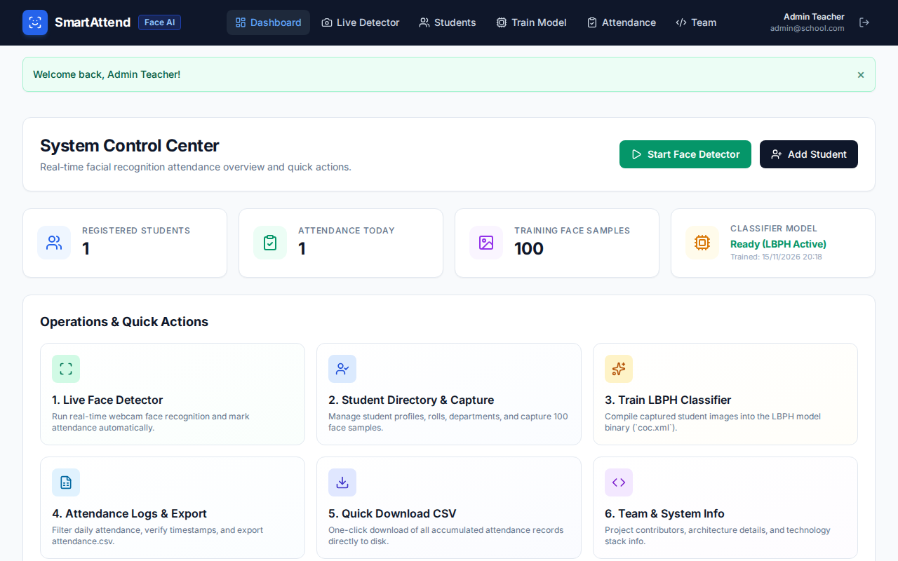
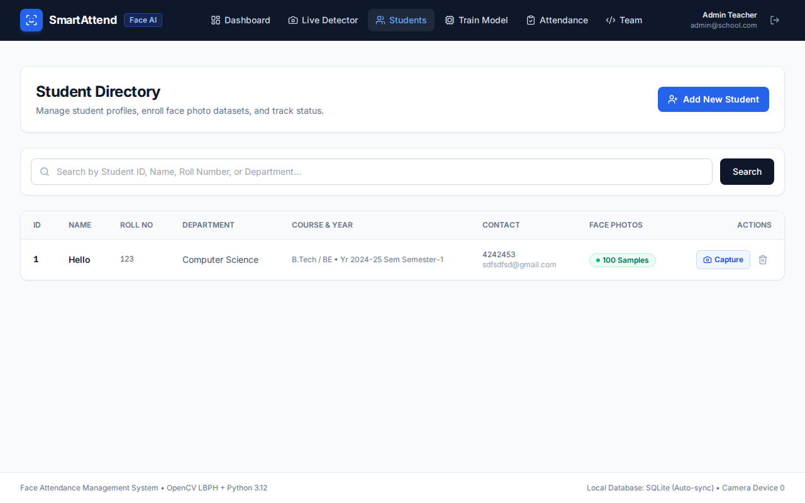
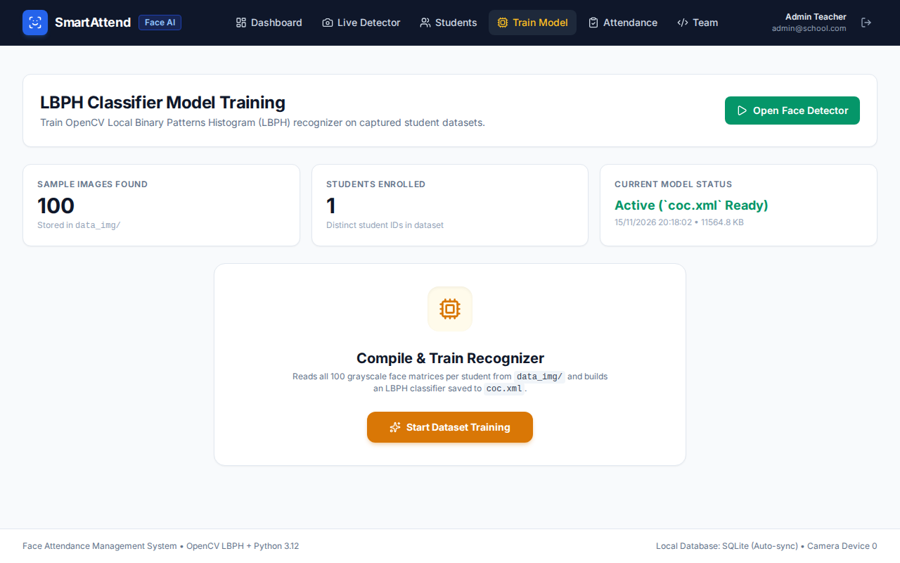
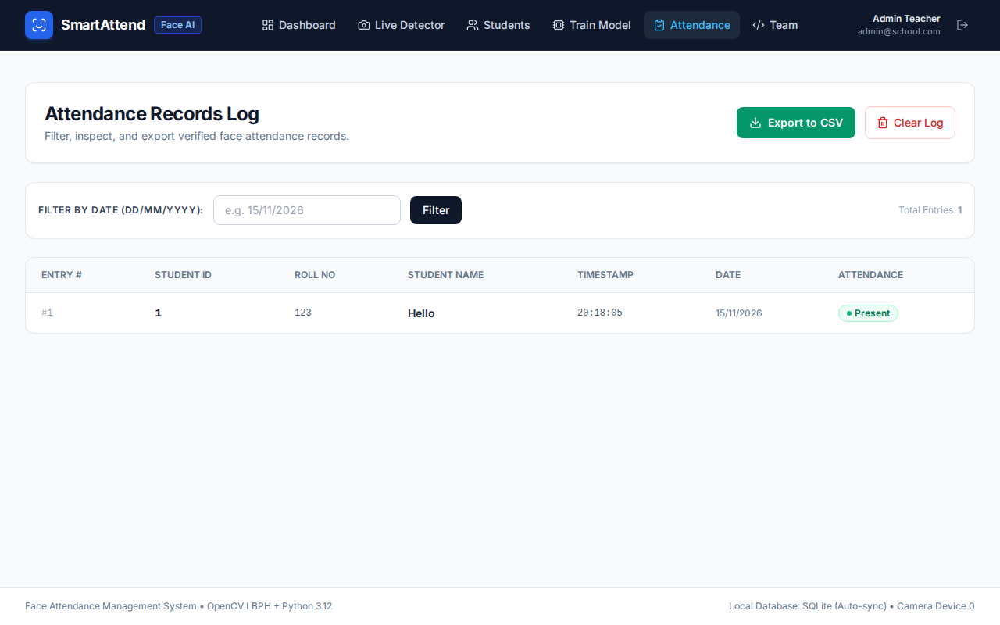
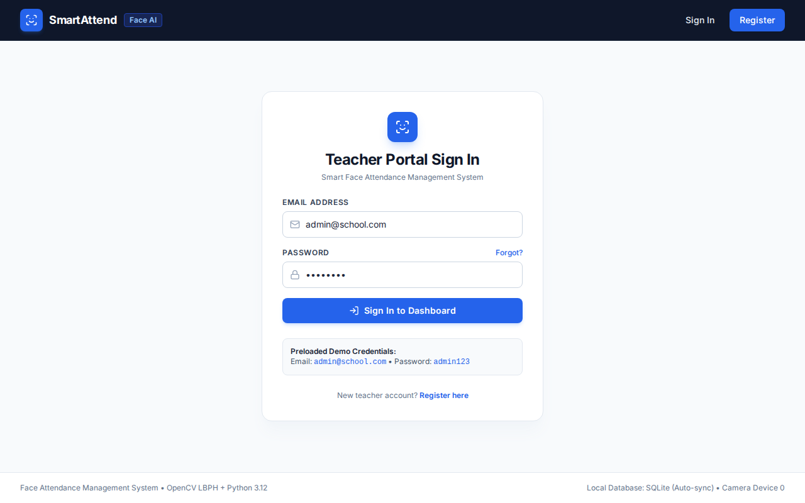
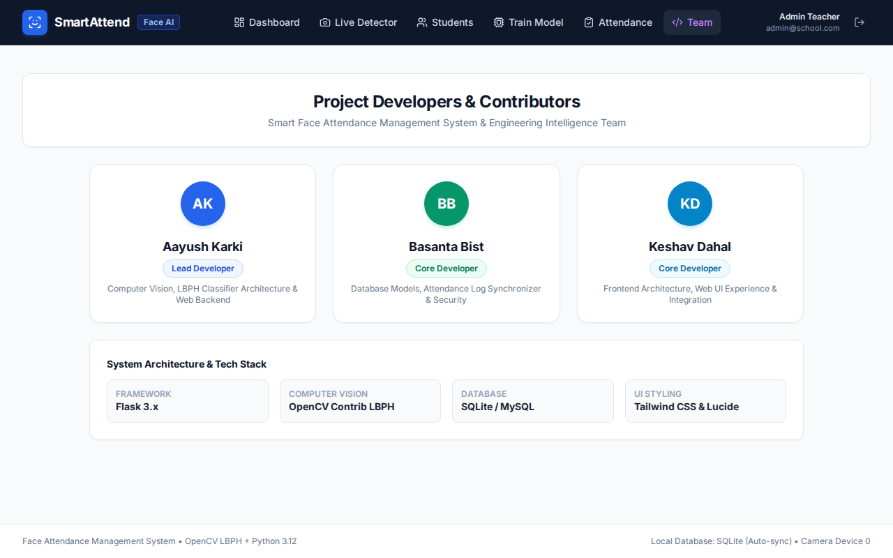

# Smart Face Attendance System

A modern, browser-based facial recognition attendance management system built with **Python 3.12**, **Flask**, **OpenCV (LBPH)**, **SQLite / MySQL**, and **Tailwind CSS**.

The system enables schools and universities to register students, automatically capture 100 webcam face training samples, train a Local Binary Patterns Histogram (LBPH) classifier model (`coc.xml`), and identify students in real time via live video stream to log attendance automatically.

---

## 📸 Application Screenshots

### 1. Central Control Center & Dashboard
Real-time summary metrics, quick navigation cards in series, and live today's attendance table.



---

### 2. Live Facial Recognition & Attendance Detector
Live MJPEG webcam stream detecting faces with Haar Cascades, verifying identity via trained LBPH model, and streaming newly logged attendees in real time.

---

### 3. Student Management & Directory
Add, update, search, and delete student records with instant status indicators for face dataset enrollment.



---

### 4. LBPH Model Classifier Training
Compile all 100-sample student face datasets in `data_img/` into the production recognizer model (`coc.xml`).



---

### 5. Attendance Records & CSV Export
Filter historical and daily attendance records by date, verify timestamps, and export attendance records directly as a CSV file.



---

### 6. Teacher Portal Authentication
Secure session-based sign-in for faculty with security-question password recovery.



---

### 7. Development & Engineering Team
Project contributors, technology stack specifications, and system architecture.



---

## 🚀 Key Features & Architectural Upgrades

- **Native Web Streaming (MJPEG):** Camera video stream is delivered directly over HTTP (`multipart/x-mixed-replace`) with bounding boxes and recognition overlays.
- **In-Memory Caching:** Cached student records in memory during live video recognition to eliminate per-frame database query bottlenecks.
- **Debounced Attendance Marking:** Automatically prevents duplicate attendance writes with a configurable 5-minute cooldown per student.
- **Zero-Config Database:** Automatically initializes local SQLite (`face_recognition.db`) out-of-the-box with optional MySQL database fallback.
- **Responsive UI:** Built with Tailwind CSS and Lucide icons for desktop, tablet, and mobile responsiveness.

---

## 🛠️ System Architecture & Workflow


1. **Teacher Sign In:** Login to the dashboard using teacher credentials.
2. **Student Enrollment:** Register student profile (ID, Name, Roll, Department, Course, Contact).
3. **Face Sampling:** Open camera view to automatically capture 100 grayscale face crops into `data_img/`.
4. **Classifier Training:** One-click training compiling the LBPH recognizer to `coc.xml`.
5. **Live Verification:** Real-time webcam identification marks students present with timestamp and confidence score.
6. **Data Export:** View and export verified attendance records to `attendance.csv`.

---

## 📦 Project Structure

```
Projects-SmartAttend/
├── app.py                              # Flask Web Server & API Controllers (Port 5050)
├── camera.py                           # OpenCV Video Streaming, Detection & LBPH Recognizer
├── database.py                         # SQLite / MySQL Data Access Layer
├── face_recognition.db                 # Auto-initialized SQLite Database
├── haarcascade_frontalface_default.xml # OpenCV Haar Feature Cascade Model
├── attendance.csv                      # Flat-file Attendance Storage
├── requirements.txt                    # Production Dependencies Manifest
├── pyproject.toml                      # Build System & Packaging Metadata
│
├── templates/                          # Tailwind CSS HTML5 Web Interface
│   ├── base.html                       # Global Layout, Navigation & Lucide Icons
│   ├── dashboard.html                  # Metric Cards, Operations & Today's Stream
│   ├── login.html                      # Teacher Authentication Portal
│   ├── register.html                   # Faculty Account Registration
│   ├── forgot_password.html            # Security Question Password Reset
│   ├── students.html                   # Student Directory Table & Registration Modal
│   ├── capture.html                    # Live Webcam Dataset Capture (1 to 100)
│   ├── detector.html                   # Real-Time Webcam Face Recognition Feed
│   ├── train.html                      # Model Compilation & Status Monitor
│   ├── attendance.html                 # Attendance Log Table & CSV Export
│   └── developers.html                 # Team Credits & Specs
│
├── assets/
│   └── screenshots/                    # High-resolution Application Previews
│       ├── 01_login.png
│       ├── 02_dashboard.png
│       ├── 03_students.png
│       ├── 05_train.png
│       ├── 06_attendance.png
│       └── 07_developers.png
│
├── data_img/                           # 100 Grayscale Face Samples per Student
│
└── Desktop GUI Modules (Legacy Support)
    ├── main.py                         # Desktop Series Dashboard
    ├── student.py                      # Desktop Student Management
    ├── face_recognition.py             # Desktop Face Detector
    ├── train.py                        # Desktop Model Trainer
    ├── attendance.py                   # Desktop Attendance Viewer
    └── login.py                        # Desktop Login Window
```

---

## ⚡ Quick Start

### 1. Clone & Setup Environment

```bash
# Clone the repository
git clone https://github.com/aayushkarki/Projects-SmartAttend.git
cd Projects-SmartAttend

# Create and activate Python 3.12 virtual environment
uv venv .venv --python 3.12
source .venv/bin/activate
```

### 2. Install Dependencies

```bash
uv pip install -r requirements.txt
```

### 3. Launch the Web Application

```bash
python app.py
```

Open your browser and navigate to:
👉 **`http://127.0.0.1:5050`**

---

## 🔑 Preloaded Demo Credentials

For testing and demonstration, use the pre-configured administrator account:

| Role | Email | Password |
| :--- | :--- | :--- |
| **Faculty Administrator** | `admin@school.com` | `admin123` |

*(You can also register a new account from the registration page).*

---

## ⚙️ Environment Configuration

Copy the example environment configuration to set your credentials securely:

```bash
cp .env.example .env
```

| Variable | Default | Purpose |
| :--- | :--- | :--- |
| `SECRET_KEY` | *(Auto-generated)* | Flask session encryption key |
| `PORT` | `5050` | Web application port |
| `ADMIN_EMAIL` | `admin@school.com` | Default demo teacher email |
| `ADMIN_PASSWORD` | `admin123` | Default demo teacher password |
| `MYSQL_HOST` | `localhost` | MySQL hostname (optional) |
| `MYSQL_PORT` | `3306` | MySQL port (optional) |
| `MYSQL_USER` | `root` | MySQL username (optional) |
| `MYSQL_PASSWORD` | `""` | MySQL password (optional) |
| `MYSQL_DATABASE` | `face_recognition` | MySQL database name |

---

## 🗄️ Database Configuration

By default, the application runs on **SQLite** (`face_recognition.db`) with zero setup required.

If you prefer connecting to a local **MySQL** server (`localhost:3306`), create the database schema:

```sql
CREATE DATABASE face_recognition;
USE face_recognition;

CREATE TABLE student (
    Student_ID VARCHAR(20) PRIMARY KEY,
    Name VARCHAR(100),
    Department VARCHAR(100),
    Course VARCHAR(100),
    Year VARCHAR(20),
    Semester VARCHAR(20),
    Division VARCHAR(20),
    Gender VARCHAR(10),
    DOB VARCHAR(20),
    Mobile_No VARCHAR(15),
    Address VARCHAR(200),
    Roll_No VARCHAR(20),
    Email VARCHAR(100),
    Teacher_Name VARCHAR(100),
    PhotoSample VARCHAR(10)
);

CREATE TABLE regteach (
    fname VARCHAR(100),
    lname VARCHAR(100),
    contact VARCHAR(15),
    email VARCHAR(100) PRIMARY KEY,
    ssq VARCHAR(100),
    sa VARCHAR(100),
    pwd VARCHAR(100)
);

CREATE TABLE stdattendance (
    id INT AUTO_INCREMENT PRIMARY KEY,
    std_id VARCHAR(20),
    std_roll_no VARCHAR(20),
    std_name VARCHAR(100),
    std_time VARCHAR(20),
    std_date VARCHAR(20),
    std_attendance VARCHAR(20)
);
```

---

## 🖥️ Running Desktop GUI (Alternative)

To launch the desktop Tkinter interface instead of the web application:

```bash
source .venv/bin/activate
python main.py
```

---

## 👥 Developers & Contributors

- **Aayush Karki** — Lead Developer (Architecture, Computer Vision & Backend)
- **Basanta Bist** — Core Developer (Database Models & Attendance Synchronizer)
- **Keshav Dahal** — Core Developer (Frontend UI & Integration)

---

## 📄 License

This project is licensed under the MIT License — see the [LICENSE](LICENSE) file for details.
